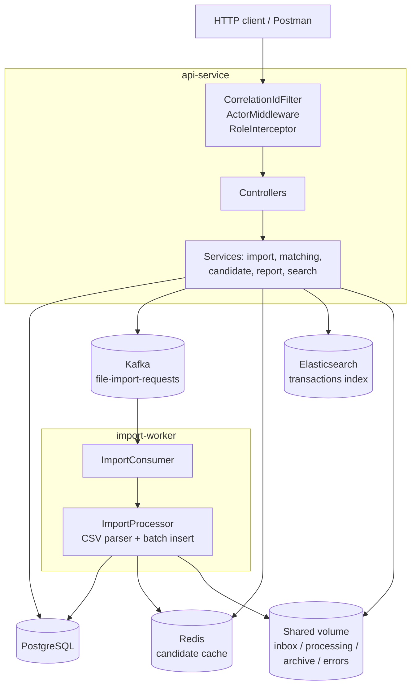
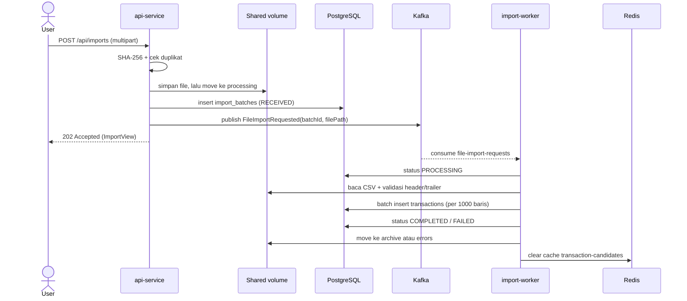

# Arsitektur

Dokumen ini menjelaskan cara kerja aplikasi secara keseluruhan: dua deployable,
peran Kafka, Redis, PostgreSQL, Elasticsearch, dan struktur monorepo.

Dokumen terkait:

- [`README.md`](../README.md) — cara menjalankan dan format file
- [`API.md`](../API.md) — referensi endpoint
- [`postman/`](../postman/README.md) — koleksi request

---

## 1. Ringkasan

Aplikasi rekonsiliasi transaksi: **CSV → PostgreSQL → manual matching maker/checker/signer**.

Ada dua aplikasi yang dijalankan terpisah:

| Deployable      | Peran                                           | Port   |
| --------------- | ----------------------------------------------- | ------ |
| `api-service`   | HTTP API, matching, report, search, intake file | `8080` |
| `import-worker` | konsumen Kafka, parsing CSV, insert transaksi   | —      |

Infrastruktur pendukung:

| Komponen      | Peran                                      | Sumber kebenaran? |
| ------------- | ------------------------------------------ | ----------------- |
| PostgreSQL    | data transaksi, match, audit, batch import | **ya**            |
| Kafka         | antrean perintah import asynchronous       | tidak             |
| Redis         | cache kandidat matching (60 detik)         | tidak             |
| Elasticsearch | indeks pencarian teks (opsional)           | tidak             |

---

## 2. Diagram komponen



---

## 3. Struktur monorepo

```text
reconciliation/
├─ pom.xml                     parent (packaging pom)
├─ common/                     library bersama, tidak dijalankan sendiri
│  └─ src/main/java/com/example/reconciliation/
│     ├─ imports/              FileImportRequested, ImportBatch,
│     │                        ImportRepository, ImportStatus
│     └─ transaction/          TransactionSource
├─ api-service/                deployable #1
│  ├─ src/main/java/com/example/reconciliation/
│  │  ├─ ApiApplication.java
│  │  ├─ config/               CorrelationIdFilter, CacheConfiguration,
│  │  │                        OpenApiConfiguration
│  │  ├─ middleware/           ActorMiddleware, RequireRole,
│  │  │                        RoleAuthorizationInterceptor,
│  │  │                        MiddlewareConfiguration
│  │  ├─ imports/              ImportController, ImportService (intake),
│  │  │                        ImportView, IncomingFileScheduler
│  │  ├─ transaction/          queue + candidates
│  │  ├─ workflow/             maker/checker/signer
│  │  ├─ report/               reconciliation report (CTE)
│  │  └─ search/               Elasticsearch
│  ├─ src/main/resources/
│  │  ├─ application.yml
│  │  └─ db/migration/         V1..V5 (pemilik Flyway)
│  └─ Dockerfile
├─ import-worker/              deployable #2
│  ├─ src/main/java/com/example/reconciliation/
│  │  ├─ WorkerApplication.java
│  │  ├─ config/               WorkerCacheConfiguration
│  │  └─ imports/              ImportConsumer, ImportProcessor,
│  │                           CsvFileParser, FileParser, ParsedRow
│  ├─ src/main/resources/application.yml
│  └─ Dockerfile
├─ compose.yaml                api + worker + PostgreSQL/Kafka/Redis/ES
└─ .github/workflows/ci.yml    test, build 2 image, publish GHCR
```

Modul `common` berisi kontrak dan model yang dipakai kedua deployable. Modul ini
tidak punya `main class` dan tidak di-repackage menjadi executable jar.

---

## 4. Alur import

### 4.1 Upload atau scan



Dua jalur masuk file:

| Jalur       | Endpoint                 | File berasal dari                         |
| ----------- | ------------------------ | ----------------------------------------- |
| Upload      | `POST /api/imports`      | multipart HTTP                            |
| Scan folder | `POST /api/imports/scan` | file yang sudah ada di `APP_IMPORT_INBOX` |

Scheduler di `api-service` memanggil logika scan yang sama setiap
`APP_IMPORT_POLL_INTERVAL_MS` (default 30 detik). File harus `.csv` dan sudah
stabil minimal 3 detik.

### 4.2 Status batch

```text
RECEIVED → PROCESSING → COMPLETED
                     ↘ FAILED
```

Batch `FAILED` bisa diulang dengan upload ulang. File dengan hash sama yang
sudah `COMPLETED`/`PROCESSING` akan dilewati.

---
